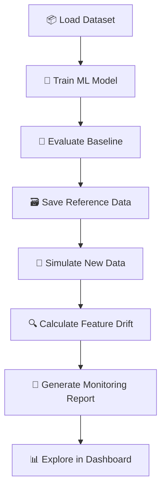

<div align="center">

# 🌊 Drifto
### ML Model Monitoring & Data Drift Dashboard

**Your model is deployed. Is it still trustworthy?**

Drifto helps make machine-learning model behaviour easier to inspect by bringing model evaluation, simulated production data, and feature-drift monitoring into one workflow.

<br/>


<br/>

**Monitor • Detect • Understand • Improve**

</div>

---

## 📌 Table of Contents

- [🔎 Overview](#-overview)
- [💡 Why Drifto?](#-why-drifto)
- [✨ Key Features](#-key-features)
- [⚙️ How It Works](#️-how-it-works)
- [🧰 Tech Stack](#-tech-stack)
- [🗂️ Project Structure](#️-project-structure)
- [🚀 Getting Started](#-getting-started)
- [📊 Understanding Drift](#-understanding-drift)
- [🖥️ Dashboard Preview](#️-dashboard-preview)
- [🛣️ Roadmap](#️-roadmap)
- [⚠️ Scope & Limitations](#️-scope--limitations)
- [🤝 Contributing](#-contributing)
- [📄 License](#-license)

---

## 🔎 Overview

Machine-learning models can continue running even when the data they receive starts to change. A successful training run does not guarantee that a model will behave just as well on future data.

**Drifto** is an educational ML monitoring project designed to demonstrate a practical monitoring workflow:

1. 🤖 **Train** a machine-learning model using a reproducible dataset.
2. 📏 **Evaluate** its baseline performance with standard classification metrics.
3. 🌊 **Simulate** new data with controlled changes to selected features.
4. 🔍 **Measure** feature-level changes between reference and simulated data.
5. 📊 **Explore** the resulting monitoring information in a dashboard.

The goal is to make model monitoring tangible, visual, and easier to understand.

## 💡 Why Drifto?

A model can be alive without being well. Data distributions change, user behaviour evolves, and upstream pipelines can introduce unexpected values. If nobody checks, the model may keep producing predictions while the assumptions behind it quietly become less reliable.

| Challenge | What it means |
|---|---|
| 🌊 **Data drift** | The distribution of model input features changes over time. |
| 🧠 **Concept drift** | The relationship between inputs and the target changes. |
| 📉 **Performance degradation** | Predictive quality worsens on newly labelled data. |
| 🧹 **Data-quality issues** | Missing, invalid, or unexpected values enter the pipeline. |

Drifto focuses on an approachable, repeatable demonstration of **feature-level data drift**. It is a learning project, not a claim that one score can diagnose every production ML problem.

## ✨ Key Features

> These descriptions should match the modules implemented in the repository. Adjust the list if your current code differs.

| Feature | Description |
|---|---|
| 🤖 **Model training** | Train a baseline classification model with scikit-learn. |
| 📏 **Baseline evaluation** | Review classification metrics such as accuracy, precision, recall, and F1-score, where implemented. |
| 🧪 **Data simulation** | Generate a comparison dataset with controlled noise or feature shifts, if enabled in the simulation module. |
| 🔍 **Feature drift scoring** | Compare reference and new feature distributions using the project's implemented scoring method. |
| 🚦 **Drift flagging** | Highlight features that cross a configurable threshold, when configured. |
| 📈 **Interactive dashboard** | Inspect available metrics, comparisons, and monitoring outputs through Streamlit. |
| 💾 **Saved artefacts** | Keep generated models, datasets, metrics, and reports reproducible where persistence is implemented. |

## ⚙️ How It Works



### The workflow at a glance

**1. Establish a baseline**  
Train and evaluate a model on a reference dataset. The baseline provides a point of comparison.

**2. Create a comparison dataset**  
Use the project's data simulation step to create new inputs with controlled changes.

**3. Compare the data**  
Calculate drift scores using the method implemented by Drifto and identify features that exceed the selected threshold.

**4. Inspect the results**  
Use the dashboard and saved reports to understand which features changed and what deserves further investigation.

## 🧰 Tech Stack

| Technology | Role |
|---|---|
| 🐍 **Python** | Core programming language |
| 🧠 **scikit-learn** | Machine-learning model and evaluation utilities |
| 🧮 **NumPy** | Numerical operations and simulation |
| 🧾 **pandas** | Tabular data handling |
| 📊 **Streamlit** | Interactive dashboard |
| 💾 **joblib / JSON / CSV** | Model and report persistence, where used |

Check `requirements.txt` for the exact versions used by your current project.

## 🗂️ Project Structure

The tree below is an **illustrative layout** for a modular Drifto implementation. Keep it aligned with the files that actually exist in your repository.

```text
drifto/
├── app.py                  # Streamlit dashboard entry point
├── requirements.txt        # Project dependencies
├── .gitignore              # Files Git should ignore
│
├── src/                    # Monitoring pipeline modules
│   ├── __init__.py
│   ├── data.py             # Load and split data
│   ├── train.py            # Train and evaluate the model
│   ├── simulate.py         # Simulate new data
│   ├── monitor.py          # Calculate drift and create reports
│   └── utils.py             # Shared helpers
│
├── models/                 # Generated model artefacts
│   └── .gitkeep
│
└── outputs/                # Generated reports and datasets
    └── .gitkeep
```

## 🚀 Getting Started

### ✅ Prerequisites

- Python **3.11 or later** (or the version specified by your project)
- Git
- A terminal, such as PowerShell or VS Code's integrated terminal

### 1️⃣ Clone the repository

```bash
git clone https://github.com/YOUR-USERNAME/YOUR-REPOSITORY.git
cd YOUR-REPOSITORY
```

> Replace the URL and folder name with your actual GitHub repository details.

### 2️⃣ Create a virtual environment

**Windows — PowerShell**

```powershell
python -m venv .venv
.\.venv\Scripts\Activate.ps1
```

**Windows — Command Prompt**

```bat
.venv\Scripts\activate.bat
```

**macOS / Linux**

```bash
python3 -m venv .venv
source .venv/bin/activate
```

### 3️⃣ Install dependencies

```bash
python -m pip install --upgrade pip
python -m pip install -r requirements.txt
```

### 4️⃣ Run the pipeline

Use the commands that correspond to the modules in your repository. If your project contains these modules, the workflow may look like this:

```bash
python -m src.train
python -m src.simulate
python -m src.monitor
```

### 5️⃣ Launch the dashboard

If `app.py` is a Streamlit application:

```bash
streamlit run app.py
```

Then open **http://localhost:8501** in your browser.

> If your entry point or module names are different, use the actual filenames in your project.

## 📊 Understanding Drift

A drift score is a signal to investigate, not an automatic verdict that a model is broken.

For example, a simple mean-shift score can compare a feature's reference and new-data averages relative to the reference spread:

\[
\text{Drift Score} = \frac{|\mu_{\text{new}} - \mu_{\text{reference}}|}{\sigma_{\text{reference}}}
\]

Where:

- \(\mu_{\text{reference}}\) is the reference-data mean.
- \(\mu_{\text{new}}\) is the new-data mean.
- \(\sigma_{\text{reference}}\) is the reference-data standard deviation.

This score is interpretable, but limited. It can miss changes in distribution shape, relationships between features, and changes in the target relationship. Constant or nearly constant reference features also require careful handling.

**Important:** This equation applies only if this is the method implemented in your monitoring code. Update this section if Drifto uses a different drift calculation.

## 🖥️ Dashboard Preview

The README will look even better with real screenshots from your running dashboard.

Create a `screenshots/` directory, add an image such as `dashboard.png`, and uncomment the example below:

```markdown
<!-- Replace with a real screenshot committed to the repository -->
<!--  -->
```

Suggested screenshots:
- 📌 Overall dashboard overview
- 📊 Feature drift comparison
- 🚦 Drift report or flagged-feature table

## 🛣️ Roadmap

Potential next steps for evolving Drifto:

- [ ] Add a polished model-health summary
- [ ] Visualize reference and new-data distributions side by side
- [ ] Add monitoring thresholds configurable from the dashboard
- [ ] Track metrics across repeated evaluation runs
- [ ] Add tests for data validation and drift calculations
- [ ] Add robust handling for missing values and constant features
- [ ] Compare the simple drift score with statistical methods such as PSI or the Kolmogorov–Smirnov test
- [ ] Add reproducible sample data and screenshots
- [ ] Explore automated alerts and scheduled monitoring

## ⚠️ Scope & Limitations

Drifto is intended as an **educational and portfolio project**.

- Simulated drift is useful for demonstrating monitoring logic, but it is not the same as monitoring a live production service.
- Feature drift does not, by itself, prove that model accuracy has declined.
- Measuring actual performance generally requires ground-truth labels and a suitable evaluation process.
- Production systems often require robust statistical tests, data validation, logging, alerting, access controls, and operational monitoring.

Be precise about what the current version implements. A good monitoring system knows the difference between a warning light and a confirmed engine failure.

## 🤝 Contributing

Ideas, bug reports, and improvements are welcome.

1. Fork the repository.
2. Create a feature branch: `git checkout -b feat/your-feature`
3. Make and test your changes.
4. Commit with a clear message: `git commit -m "Add your feature"`
5. Push your branch and open a pull request.

## 📄 License

No license is implied by this README. If you intend to publish Drifto as open source, choose a license and add the corresponding `LICENSE` file. Update this section once that is done.

---

<div align="center">

### 🌊 Drifto
**See the shift. Understand the signal. Monitor with confidence.**

Built with 🧠, Python, and a healthy suspicion of models left unattended.

</div>
